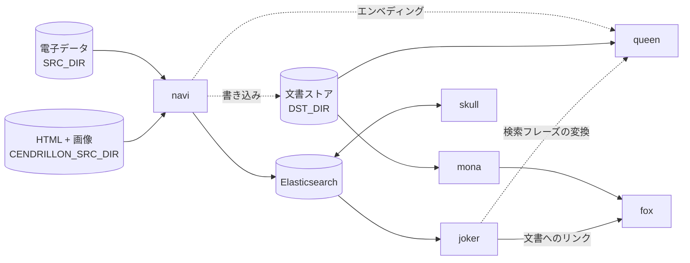

# phantom

特許庁のインターネット出願ソフトで扱う特許文書（電子データ）を取り込み、
全文検索・画像検索できるようにするシステム。
将来的には、担当者・整理番号・技術分類タグ・作業メモなどのメタ情報を管理する
特許管理システムへの発展を見据えている。

[phantom-old](https://github.com/hyperion13th144m/phantom-old) を一から設計し直したもの。

## できること

- インターネット出願ソフトの電子データ（JWX/JWS/JPC/JPD + 対の手続XML）を
  置いておくだけで、展開・変換・エンベディング生成・Elasticsearch 登録までを自動で行う
- **検索** — キーワード / 厳密 / セマンティック / ハイブリッドの簡易検索、
  フィールド単位の詳細検索、図面の画像検索（類似画像検索つき）、書誌検索
- **閲覧** — 文書を HTML でレンダリング（図面カルーセル・目次・キーワードハイライト）
- **メタ情報** — 内部整理番号・外部整理番号・タグ・担当者を文書に紐づけて検索に反映

## 構成

文書の取り込みは navi が1つのプロセスで行う（展開 → 変換 → 書誌 → 画像 → 登録。
XML が残っていない文書は HTML から取り込み、登録の段で合流する）。エンベディングのモデルは
queen（モデルサーバー）が常駐させ、navi の取り込みと joker の検索の両方が使う。
そのあとを検索・閲覧・メタ情報の各サービスが受け持つ。



| サービス | 役割 | 種別 |
| --- | --- | --- |
| [navi](https://github.com/hyperion13th144m/phantom/blob/main/services/navi/README.md) | 取り込み（`SRC_DIR` を走査し、XML の SHA-256 を文書IDとして展開、XSL で JSON 化、画像の WebP 変換、書誌と本文の抽出、OCR、エンベディング、Elasticsearch への登録）と、その管理 UI | 取り込み |
| [queen](https://github.com/hyperion13th144m/phantom/blob/main/services/queen/README.md) | モデルサーバー。ruri（文書・検索フレーズ）と CLIP（画像・検索フレーズ）のエンベディング | 取り込み・検索 |
| [skull](https://github.com/hyperion13th144m/phantom/blob/main/services/skull/README.md) | メタ情報（整理番号・タグ・担当者）の管理 UI と Elasticsearch への同期 | 運用 |
| [joker](https://github.com/hyperion13th144m/phantom/blob/main/services/joker/README.md) | 検索 UI・検索 API（Astro / SSR） | フロント |
| [fox](https://github.com/hyperion13th144m/phantom/blob/main/services/fox/README.md) | 文書ビューア（Astro / SSR）。XML 由来・HTML 由来のどちらも表示する | フロント |
| [mona](https://github.com/hyperion13th144m/phantom/blob/main/services/mona/README.md) | 文書ストアのファイル配信（JSON・画像） | フロント |

取り込みは「処理済みの目印のファイルがあればその段をスキップ」する冪等な作りなので、
何度実行しても差分だけが処理される。以前は取り込みの各段が別々のサービス
（crow・queen・noir・violet・panther・cendrillon）だった（[設計書](docs/python-new-loop-design.md)）。

## リポジトリ構成

uv workspace のモノレポ（fox / joker は npm プロジェクトなので workspace からは除外）。

```
services/            各サービス（navi, queen, skull, joker, fox, mona）
libs/python/         Python 共有パッケージ（taskservice, docstore, jpo_schema, whitelist）
libs/typescript/     TypeScript 型生成用パッケージ（jpo-schema）
libs/jpo-schema/     特許文書 XML → JSON 変換の XSLT 資産
infra/es/            Elasticsearch のマッピングとプラグイン入りイメージ
infra/whitelist/     取り込む書類の対象表（navi が読む）
infra/nginx/         本番用リバースプロキシ設定
scripts/             型定義・型ガードの生成スクリプト、phantom-launcher（Windows ネイティブでの起動管理）
docs/                手順書（下記）
```

## ドキュメント

| ドキュメント | 内容 |
| --- | --- |
| [開発環境の用意](docs/development.md) | 必要なもの、`uv sync`、環境変数、各サービスの起動、テスト |
| [本番環境のセットアップ](docs/production.md) | docker compose での構築、nginx のルーティング、更新とバックアップ |
| [Windows ネイティブで動かす](docs/windows-native.md) | Docker・WSL を使わずに Windows で動かす手順と、実機での結果 |
| [運用方法](docs/operations.md) | navi での取り込み、skull でのメタ情報管理と同期 |
| [検索の使い方](docs/search.md) | joker の簡易検索・詳細検索・画像検索・書誌検索 |

## ライセンス

[License 1.0](LICENSE.md) — 非商用利用に限る。
