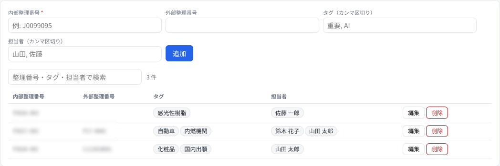
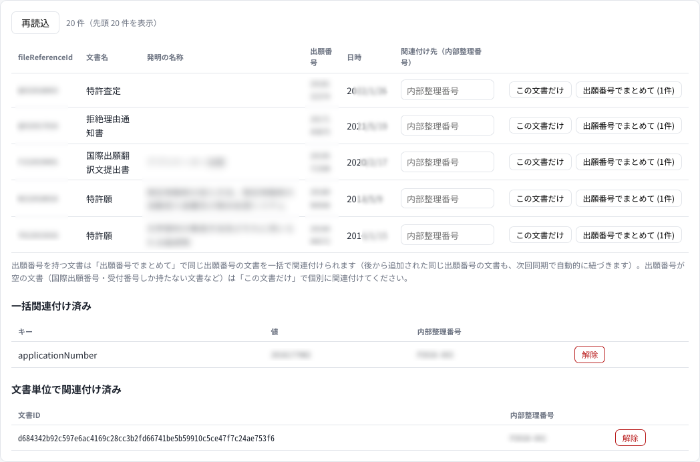

# 運用方法

日々の運用は2つの画面で行う。

- **navi** — 電子データを取り込んで検索できる状態にする
- **skull** — 文書に整理番号・タグ・担当者を付け、Elasticsearch に反映する

| | 開発環境（既定） | 本番（nginx 経由） |
| --- | --- | --- |
| navi | http://localhost:8005/ | `http://<host>:<port>/navi/` |
| skull | http://localhost:8007/ | `http://<host>:<port>/skull/` |

## 全体の流れ

```
電子データを SRC_DIR に置く
        ↓
navi で「取り込み開始」                … 展開 → 変換 → 書誌 → 画像 → 登録（HTML 由来は HTML → 登録）
        ↓
joker で検索できる状態になる（1件ずつ、処理が終わった文書から順に出る）
        ↓
skull でメタ情報を登録・関連付け
        ↓
skull で「同期開始」                   … 整理番号・タグ・担当者が検索に反映される
```

新しい電子データが増えたら、この流れをもう一度なぞるだけでよい。
処理済みの段はスキップするので、毎回全件を流して構わない（約 700 件の元データで、処理済みなら 1 分ほど）。

---

# navi — 取り込む

画面は上から3つの部分からなる。

- **取り込み** — 開始（XML・HTML の選択、件数の上限）と中止。進み具合、走査済み・検索に出た・完了・対象外・失敗の件数、
  処理速度と残りの見込み、段ごとの件数、処理中の文書とそれぞれの段
- **履歴** — 直近の実行。行を押すと、失敗した文書の一覧（段と traceback の末尾）を開く
- **サービス** — queen・mona・fox・joker・skull・Elasticsearch の死活監視

## 取り込みの流れ

「取り込み開始」を押すと、navi が元データを走査し、文書ごとに次の段を最初から最後まで流す。
同時に流す文書の数は `NAVI_DOC_CONCURRENCY`（既定 4）。

| 段 | すること | 処理済みの目印 |
| --- | --- | --- |
| 展開（extract） | XML の SHA-256 を文書IDとして、アーカイブを文書ストアに展開する。取り込む書類の対象表にない書類はここで「対象外」になる | 文書ディレクトリ |
| 変換（convert） | XML を XSL で JSON にし、画像を WebP に変換する | `json/document.json` |
| 書誌（properties） | 書誌事項と本文を取り出し、文書のエンベディングを queen に頼む | `json/document-properties.json` |
| 画像（images） | 図の情報、OCR（文字が主体の画像だけ）、画像のエンベディング（queen） | `json/images-properties.json` |
| HTML（html） | XML の無い文書を、HTML と画像から同じ形の JSON にする | 文書ディレクトリと JSON 一式 |
| 登録（upload） | Elasticsearch の文書・画像インデックスに登録する | `json/doc.json`・`json/img.json` |

- 段の目印のファイルがあれば、その段はスキップして次の段に進む
- ある段が失敗したら、その文書はそこで打ち切る（「失敗」に数え、履歴から理由を見られる）。
  次に取り込んだときに、目印の無い段からやり直される
- 「中止」は、処理中の各文書がいまの段を終えたところで効く。**再開はしない**（もう一度開始すると、
  未処理の段だけが処理される）
- 同じ文書（同じ XML / HTML）が元データの2か所にあれば、1回だけ流す（「重複」）
- 実行の履歴は `NAVI_STATE_DIR` に残るので、navi を再起動しても消えない

## 覚えておくとよいこと

- 取り込みは同時に1つしか実行しない。実行中に開始すると 409 が返る
- navi はアイドル時は何もポーリングしない。UI を開いている間だけ状況を読みに行く
- queen（モデルサーバー）が落ちていると、書誌・画像・HTML の段がすべて失敗になる。サービスの欄で queen が緑か確かめる

## API で操作する

UI を使わずに動かす場合（cron やタスクスケジューラから回す、など）。

```bash
# 取り込みを始める（sources・maxDocuments は省略可）
curl -X POST localhost:8005/api/runs -H 'content-type: application/json'   -d '{"sources": ["xml", "html"], "maxDocuments": null}'
curl localhost:8005/api/runs/current          # 実行中（か直近）の状況
curl -X POST localhost:8005/api/runs/current/cancel
curl localhost:8005/api/runs                  # 履歴
curl localhost:8005/api/runs/<runId>/failures # 失敗した文書
```

## 画像のエンベディングを作り直す

CLIP のモデルを変えると、既存の画像ベクトルは別の空間のものになって
類似画像検索・画像のセマンティック検索が意味を成さなくなる。全画像の作り直しが要る。

画像の段は `json/images-properties.json` があるかどうかで処理済みを判定するので、
先に消してから流す。登録の段も `json/doc.json`・`json/img.json` があればスキップするので、一緒に消す。
OCR テキストも同じファイルに入っているため、再実行では OCR もやり直しになる（時間がかかる）。

```bash
find "$PHANTOM_DATA_DIR" \( -name images-properties.json -o -name doc.json -o -name img.json \) -delete
curl -X POST localhost:8005/api/runs -H 'content-type: application/json' -d '{}'
```

HTML から取り込んだ文書は、HTML の段が画像のエンベディングまでまとめて作る。HTML の段は無い JSON だけを作り直すので、
`document-properties.json` を残しておけばテキスト側は再計算されない。

## うまくいかないとき

| 症状 | 見るところ |
| --- | --- |
| 実行がすぐ「失敗」になる | 履歴のメッセージ。元データのディレクトリが見えない、XSL が見つからない、Elasticsearch に繋がらない、のどれか |
| 文書が「失敗」になる | 履歴の行を押して、失敗した段と traceback を見る。navi のログ |
| 書誌・画像の段がすべて失敗する | queen が動いているか（サービスの欄、`QUEEN_URL`） |
| 「対象外」が多い | 取り込む書類の対象表（`WHITE_LIST_PATH`、[infra/whitelist](../infra/whitelist/README.md)）に無い書類 |
| 特定の文書だけ作り直したい | 文書ディレクトリの該当する出力 JSON（と `json/doc.json`・`json/img.json`）を消して再実行する |
| サービスのランプが赤 | そのサービスが落ちている。`*_URL` の設定と health を確認する |

---

# skull — メタ情報を管理する

skull は、文書に **内部整理番号（主キー）・外部整理番号・タグ・担当者** を付け、
Elasticsearch 上の文書・画像に反映するサービス。
付いたメタ情報は joker の検索対象になる。

## 1. メタ情報を登録する



内部整理番号だけが必須。タグと担当者はカンマ区切りで複数入れられる。
一覧は整理番号・タグ・担当者の部分一致で検索でき、行ごとに編集・削除ができる。

内部整理番号は主キーなので後から変更できない。変える場合は削除して作り直す。

## 2. 文書と関連付ける

文書とメタ情報の結びつけには3つの経路がある。
同じ文書に複数当てはまった場合は、**対象が狭いものほど強い**。

| 優先 | 経路 | どう決まるか |
| --- | --- | --- |
| 弱 | 外部整理番号の一致（自動） | ES の `fileReferenceId` が外部整理番号と一致する文書 |
| ↓ | 内部整理番号の一致（自動） | ES の `fileReferenceId` が内部整理番号と一致する文書 |
| ↓ | 一括関連付け | 書誌キー（既定は出願番号）の値が一致する文書すべて |
| 強 | 文書単位の手動関連付け | その文書1件だけ |

整理番号が一致する文書は登録しただけで自動的に紐づくので、
手当てが必要なのは「一致しなかった文書」だけになる。

## 3. 未対応文書を関連付ける



「未対応文書」は、整理番号に一致せず、どちらの関連付けの対象でもない ES 上の文書。
各行で内部整理番号を入れて、2つのうちどちらかを押す。

- **この文書だけ** — その文書1件を関連付ける
- **出願番号でまとめて (N件)** — 同じ出願番号を持つ文書をまとめて関連付ける。
  N はその時点の該当件数

一括関連付けは**文書IDではなく出願番号の値そのものを保存し、対象文書は同期のたびに
Elasticsearch で解決し直す**。そのため、同じ案件の文書が後から取り込まれても、
次の同期で自動的に紐づく。案件単位で管理したいときはこちらを使う。

> **出願番号が空の文書には一括の操作が出ない。**
> ES 上では空の書誌項目がキー欠落ではなく空文字として入っているため、
> 空の値で一括関連付けを許すと、出願番号を持たない文書がまとめて
> 1つのメタ情報に巻き込まれてしまう。国際出願番号・受付番号しか持たない
> PCT 系の文書などは「この文書だけ」で個別に関連付ける。

関連付けは下の「一括関連付け済み」「文書単位で関連付け済み」の表から解除できる。
メタ情報を削除すると、その関連付けも一緒に消える。

## 4. 同期する


**DB を編集しただけでは検索に反映されない。**「同期開始」を押して初めて
Elasticsearch に書き込まれる。

同期は「あるべき状態」と「現在の状態」を突き合わせて差分だけを反映する
冪等なリコンサイル処理になっている。

- あるべき状態 = DB のメタ情報 × 整理番号一致 + 一括関連付け + 手動関連付け
- 現在の状態 = ES 上で `intRefNumber` が付いている文書
- 差分を文書インデックスに `update`、同じ `docId` の画像に `update_by_query` で反映し、
  対象から外れた文書からはメタ情報フィールドを削除する

この方式なので、navi の取り込みが文書を登録し直してメタ情報が消えても、
同期を実行し直せば復元される。何度実行しても副作用はないので、
迷ったら流してよい（変化が無い文書は `skipped` になる）。

開始時に、メタ情報フィールド（`intRefNumber` / `extRefNumber` / `tags` / `assignees`）の
マッピングを既存インデックスへ冪等に追加する。文書インデックスが無い場合は
タスクを開始しないので、先に navi で取り込んでおくこと。

API から実行する場合は次のとおり。

```bash
curl -X POST localhost:8007/tasks -H 'content-type: application/json' \
  -d '{"name": "sync", "params": {}}'
curl localhost:8007/tasks/current
curl -X POST localhost:8007/tasks/current/cancel
```

メタ情報の CRUD・関連付け・未対応文書一覧も API で操作できる。
一覧は [skull の README](https://github.com/hyperion13th144m/phantom/blob/main/services/skull/README.md#api) を参照。

## 一括関連付けに使えるキーを増やす

現在使えるキーは出願番号（`applicationNumber`）のみ。
キーの値はそのまま Elasticsearch のフィールド名なので、
`services/skull/src/skull/db.py` の `GROUP_KEY_TYPES` に1行足せば増やせる。
